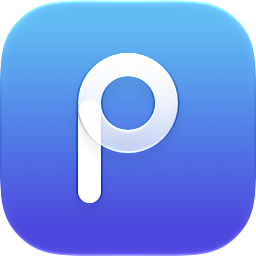

<p align="center">
  <picture>
    <source media="(prefers-color-scheme: dark)" srcset="docs/images/icon-dark.png">
    
  </picture>
</p>

<h1 align="center">pob</h1>

<p align="center">
  <strong>Plain Ol' Browser</strong><br>
  A minimal macOS browser, built on WebKit.<br>
  The page fills the window. The controls come up only when you call them.
</p>

<p align="center">
  
  
  
</p>

---

## Why pob

Each year, most browsers add more toolbars, sidebars, accounts and assistants. pob goes the other way. It does what a work day needs, and nothing more.

- **The page is the app.** There is no toolbar, no tab strip and no title bar.
- **Controls when you ask.** The rail, the switcher and the pills come up on request, then go away.
- **The keyboard first.** Every action has a shortcut, and a key press never waits for an animation.
- **Fast.** A new tab is ready to type in about 5 ms, and the app opens to its first page in about 0.3 s.

pob is a personal browser for one Mac. It is not notarized, and it has no auto-updates.

## Highlights

### A quiet window

- **The rail.** A floating Liquid Glass panel with back, forward, reload, the address field, your bookmarks, your open tabs, the profile, downloads and settings. Move the pointer to the left edge to show it, or press ⌘B to pin it open.
- **The switcher.** Press ⌘T for one field that searches open tabs, bookmarks, history and commands. Type an address or a search, then press Return.
- **Shift to peek.** Hold Shift on its own for a moment. Back and forward come up at the top left, and the page's address comes up at the bottom left. Click the address to copy it.
- **Glass where Apple permits it.** The rail, the switcher, the pills and the popovers use Liquid Glass. The page never does.
- **See-through windows.** Set the window transparency (0–80%) and the desktop blur (0–40) from the rail. Press ⌥⌘O to make the window opaque before you share your screen.

### Private and clean

- **Built-in ad blocking.** EasyList and EasyPrivacy compile into WebKit's own content rules, with no extension. Turn off blocking for one site, or use **Load anyway** for one blocked page.
- **Profiles.** Each profile has its own cookies, logins, history, bookmarks and tabs. Switch a window's profile from the rail.
- **Private windows.** ⇧⌘N opens a window that writes nothing to disk.
- **Clear addresses.** International host names show as punycode, so a lookalike domain is easy to see.
- **No surprises.** pob asks before each download, and before a link opens another app such as Teams, Zoom or Mail.

### Ready for work

- **The Safari engine.** pob uses `WKWebView`, so pages render as they do in Safari. H.264 video and Google sign-in work.
- **Developer tools.** Web Inspector docks in the window (⌥⌘I), with Console (⌥⌘C) and Page Source (⌥⌘U).
- **Bookmarks with folders.** Add, rename and move bookmarks from the rail. Import them from Safari or Chrome.
- **Session restore.** Windows and tabs come back after a quit or a crash. At launch, only the active tab loads.
- **Light on memory.** Background tabs slow down, then pause, then release their web view. A tab in a call stays live.
- **The usual tools.** Find in page, print, zoom for each site, and camera, microphone and location prompts that pob remembers for each site.
- **Default browser.** pob can open links from other apps.

## Speed

Measured on an Apple M5 Pro with a Debug build.

| Action | Target | Median |
|---|---|---|
| ⌘T to typing | Under 50 ms | 5.2 ms |
| Switch to a live tab | Under 50 ms | 1.5 ms |
| Switch to a saved tab | Under 50 ms | 18.8 ms |
| Launch to first page | Under 500 ms | 298 ms |

## Keyboard shortcuts

| Action | Shortcut |
|---|---|
| New tab (opens the switcher) | ⌘T |
| Open the switcher | ⌘K |
| Address field | ⌘L |
| Pin or unpin the rail | ⌘B |
| Back and forward pill, address pill | Hold ⇧ alone |
| Close tab, close window | ⌘W, ⇧⌘W |
| Reopen closed tab | ⇧⌘T |
| Next tab, previous tab | ⌃⇥, ⌃⇧⇥ |
| Go to tab 1–8, go to last tab | ⌘1–⌘8, ⌘9 |
| New window, new private window | ⌘N, ⇧⌘N |
| Back, forward, reload | ⌘[, ⌘], ⌘R |
| Find in page | ⌘F |
| Bookmark this page | ⌘D |
| Zoom in, zoom out, actual size | ⌘+, ⌘−, ⌘0 |
| Snap to opaque | ⌥⌘O |
| Web Inspector, Console, Page Source | ⌥⌘I, ⌥⌘C, ⌥⌘U |
| Print | ⌘P |
| Settings | ⌘, |

⌘T, ⇧⌘T, ⌘L, ⌘W, ⇧⌘W, ⌘N, ⇧⌘N, ⌘1–⌘9 and ⌃⇥ always go to pob. For all other shortcuts, the page gets the first chance, so a web app can keep ⌘B for bold. The left edge always opens the rail.

## Build and run

### Requirements

- macOS 27 or later
- Xcode 27 or later
- [XcodeGen](https://github.com/yonaskolb/XcodeGen) (`brew install xcodegen`)
- An Apple Development certificate

### Steps

1. Generate the Xcode project. The project file is not in git. XcodeGen picks up new source files automatically, so run it again only when `project.yml` changes.

   ```sh
   xcodegen generate
   ```

2. If you use a different Apple account, change `CODE_SIGN_IDENTITY` and `DEVELOPMENT_TEAM` in `project.yml`.

   > [!WARNING]
   > Do not use ad-hoc signing. Each ad-hoc build gets a new identity, so macOS forgets pob's Keychain access and its camera, microphone and screen permissions.

3. Open `pob.xcodeproj` in Xcode once, and click **Trust & Enable** for the SafariConverterLib build plugin. Command-line builds fail until you trust it.

4. Build and open the app:

   ```sh
   xcodebuild build -project pob.xcodeproj -scheme pob -destination 'platform=macOS,arch=arm64' -derivedDataPath build/dd && open build/dd/Build/Products/Debug/pob.app
   ```

### Tests

The tests use Swift Testing. Run them all:

```sh
xcodebuild test -project pob.xcodeproj -scheme pob -destination 'platform=macOS,arch=arm64' -derivedDataPath build/dd
```

The speed tests run only when you ask for them:

```sh
TEST_RUNNER_POB_SPEED=1 xcodebuild test -project pob.xcodeproj -scheme pob -destination 'platform=macOS,arch=arm64' -derivedDataPath build/dd -only-testing:pobTests/SpeedTests
```

## How it is built

- **Engine:** WebKit through `WKWebView`. H.264 and AAC play with no custom engine build, and the app stays small.
- **Shell:** Swift 6 and AppKit, with the main actor as the default isolation. Only the Settings window uses SwiftUI.
- **One list of commands:** each action is one entry in `pob/App/Commands.swift`. That entry puts the action in the menu bar and the switcher. To add a feature, start there.
- **Private APIs in one file:** the desktop blur, the window corners and the docked Web Inspector use private APIs. They are all in `pob/Private/PrivateAPI.swift`, each one has a public fallback, and a test fails if a macOS update removes one.

| Folder | Contents |
|---|---|
| `pob/App` | App lifecycle, menu bar, the command list, speed signposts |
| `pob/Window` | Window setup, transparency, blur, the edge trigger, Shift hold, motion |
| `pob/Chrome` | Rail, switcher, pills, find bar, popovers, bookmark editors |
| `pob/Tab` | One web view for each tab, tab lifecycle, address input, error pages |
| `pob/Profile` | Profiles, bookmarks, history (SQLite with FTS5), session, site settings, icons |
| `pob/Services` | Ad blocking, downloads, permissions |
| `pob/Settings` | The Settings window |
| `pob/Private` | The only file that uses private APIs |
| `pob/Lists` | The bundled EasyList and EasyPrivacy snapshots |
| `pobTests` | The test suites |
| `Config` | `Info.plist` and entitlements |
| `docs` | The design spec, the stage plans and their results |

### Your data

pob keeps its data in `~/Library/Application Support/pob/`. Each profile has a folder for its bookmarks, session, history and site settings. WebKit keeps the cookies and site data of each profile apart.

> [!TIP]
> Back up this folder before you try a new build on your real profile.

## What pob does not do

- **Passwords.** pob stores no passwords. Apple's iCloud Passwords extension serves only Chrome, Edge and Firefox, so copy logins from the Passwords menu bar item.
- **Passkeys.** iCloud passkeys need an entitlement that Apple gives only to organizations.
- **Site notifications.** WebKit has no public API for them, so Teams and Gmail alerts do not show.
- **Extensions, sync, reader mode, translation and AI features.**
- **Some ads.** Ads that need scripts to remove can get through.

If a site does not work in pob, run **Open in Safari** from the switcher.

## Docs

- [Design spec](docs/superpowers/specs/2026-11-04-pob-browser-design.md): the goals, the decisions and the reasons for them
- [Stage 1 results](docs/stage-1-results.md): the engine checks
- [Stage 2 results](docs/stage-2-results.md): the daily driver
- [Stage 3 results](docs/stage-3-results.md): profiles, private windows, Settings and the speed pass

## Credits

- [SafariConverterLib](https://github.com/AdguardTeam/SafariConverterLib) by AdGuard converts the filter lists into WebKit rules. It is GPL-3.0, so a distributed copy of pob must follow the GPL.
- [EasyList and EasyPrivacy](https://easylist.to) supply the ad and tracker rules.
